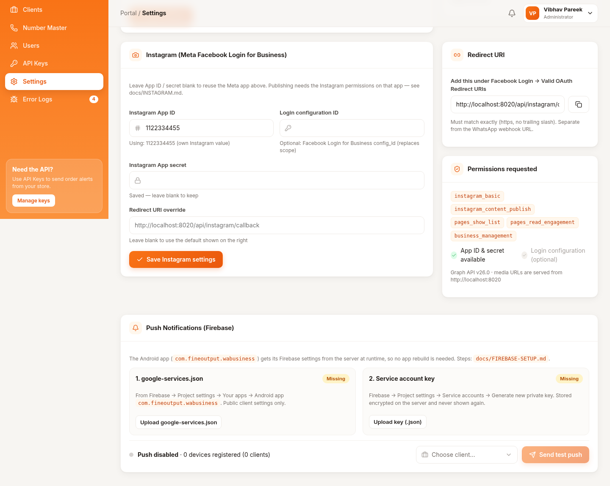
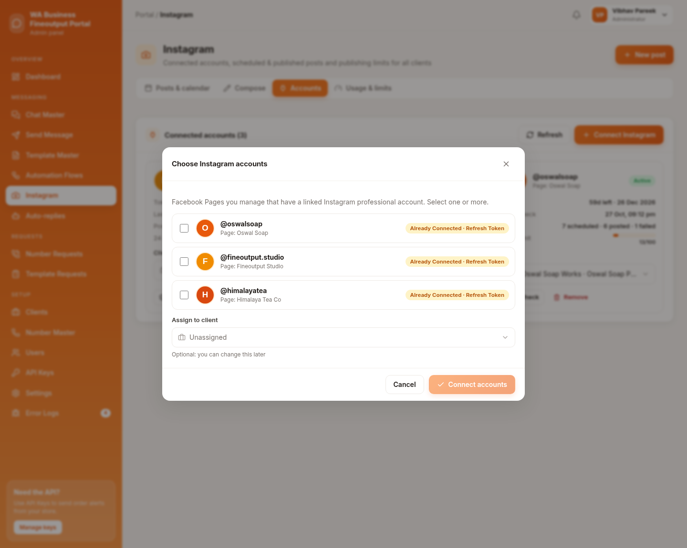
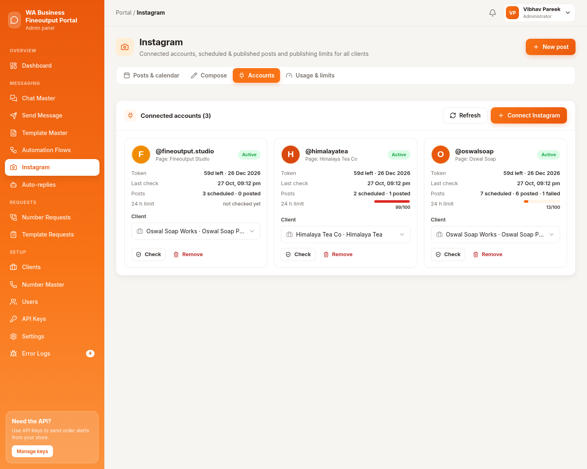
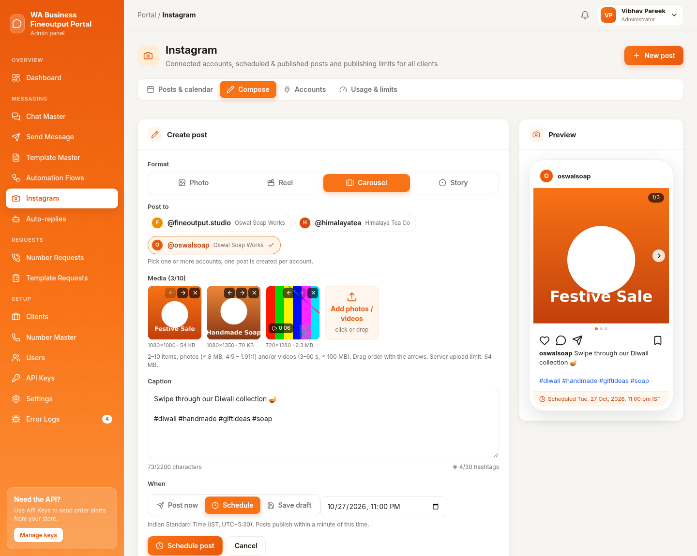
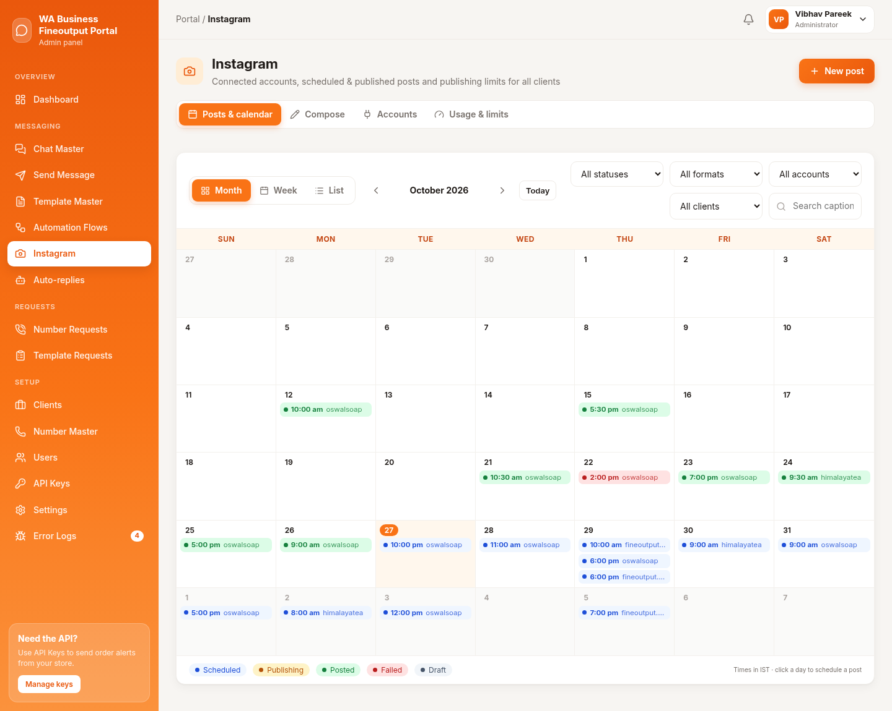
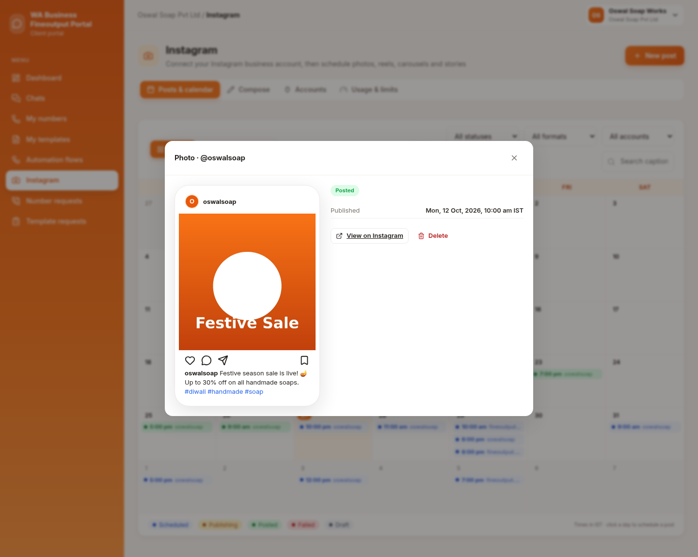
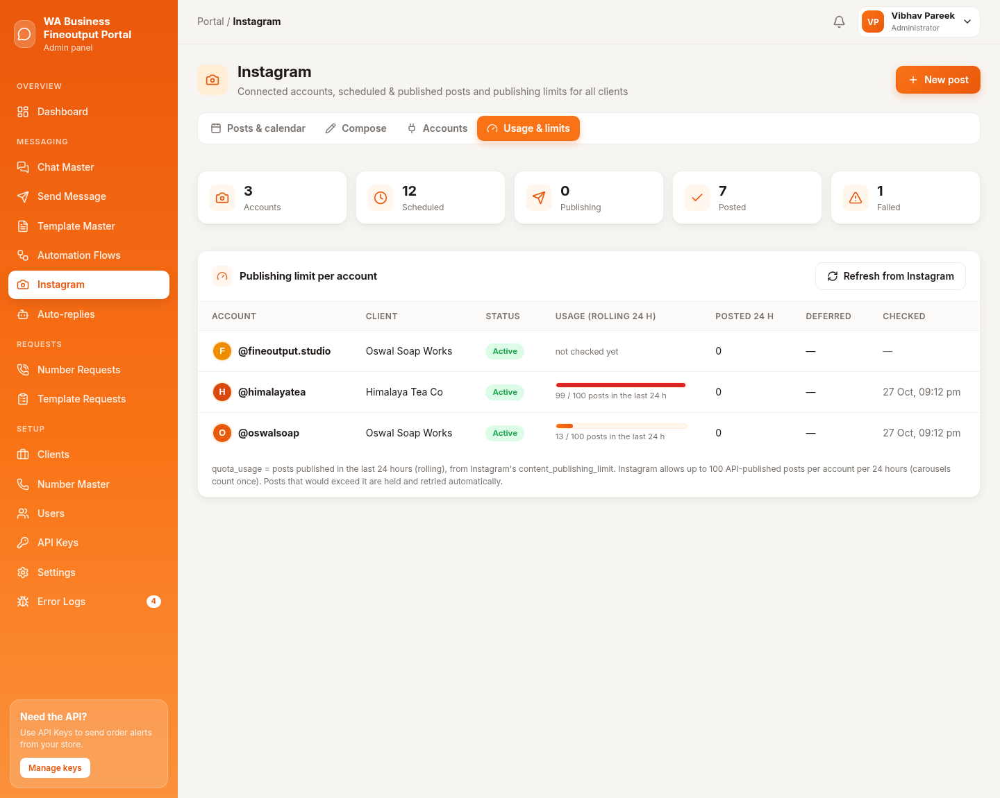

# Instagram in the WA Business Fineoutput Portal — easy guide

For Vibhav. Part A you do **once**. Part B is what you (or a client) do every day.
The more technical version is in `docs/INSTAGRAM.md`.

---

## Part A — One-time setup (admin)

### A1. Make the Instagram account a "Business" account linked to a Facebook Page

Do this in the Instagram phone app, for every account you want to post to.

1. Open Instagram → tap your **profile picture** (bottom right) → tap the **☰ menu** (top right).
2. Tap **Account type and tools** → **Switch to professional account**. Choose **Business** (or **Creator**). Finish the steps.
3. Back in the ☰ menu, find **Accounts Center** or **Business tools / Linked accounts** → **Facebook Page** and connect the Page. (Meta moves these menus around; if you don't see them, search "link Facebook Page" in Instagram's settings.)
4. Done when the Page's settings on Facebook show the Instagram account as **linked**.

> Why: Instagram only lets outside apps post to a professional (business/creator) account that has a Facebook Page "attached" to it.

### A2. Set up the Meta app (on developers.facebook.com)

The "Meta app" is the key that lets our portal talk to Instagram. You can use the same app you already use for WhatsApp.

1. Go to **developers.facebook.com** → **My Apps** → open your app (or **Create app** → type **Business**).
2. Find **Add product** (sometimes called "Add use case"). Add **Facebook Login for Business**. If you see **Instagram Graph API** / "Instagram (with Facebook Login)" in the list, add it too. Meta's screens change often; the names may be slightly different.
3. Open **Facebook Login for Business → Settings**. In **Valid OAuth Redirect URIs** paste exactly:

   `https://whatsappwork.fineoutput.com/api/instagram/callback`

   (No space and no "/" at the end. This is the page Facebook sends people back to after they log in.) Click **Save**.
4. Permissions (what the app is allowed to do). Make sure these 5 are added:
   - `instagram_basic`: see the account name and photo
   - `instagram_content_publish`: post photos, reels, carousels and stories
   - `pages_show_list`: see your Facebook Pages
   - `pages_read_engagement`: find which Instagram account is linked to a Page
   - `business_management`: needed when the Page belongs to a Business account
5. *(Optional)* **Facebook Login for Business → Configurations → Create configuration**. Tick Pages, Instagram accounts and the 5 permissions above. Copy the **Configuration ID** (a long number). You will paste it in the portal in A4.
6. In **App settings → Basic**, copy the **App ID** and **App secret** (click "Show").

### A3. Testing before Meta approves the app ("Development mode")

Until Meta approves the app, **only people added to the app** can connect.

1. In the app, go to **App roles → Roles** → **Add people**. Add yourself and any tester as **Tester** (or Developer/Admin).
2. Each person accepts the invite (Facebook notification, or developers.facebook.com → their settings → Roles).
3. That person must manage the Facebook Page, and the Instagram account must be linked to it (A1).
4. Test fully with your own account first.

**Going live for all clients (when ready):**
1. **Business Verification**: Meta checks your company documents (Business Settings → Security Center → Start verification).
2. **App Review**: ask for "Advanced Access" to the 5 permissions. Meta wants a short screen recording and a short explanation for each permission. Ready-made texts and a recording script are in `docs/INSTAGRAM.md` (section 10). Copy them, then record yourself doing Part B.
3. After approval, switch the app from **Development** to **Live**.

### A4. Fill in the portal settings

1. Log in to the admin panel: `whatsappwork.fineoutput.com/wab-control-7x` → **Settings**.
2. Scroll to the card **Instagram (Meta Facebook Login for Business)**.
3. **Instagram App ID** and **Instagram App secret**: paste from A2 step 6. *Leave both empty to reuse the WhatsApp Meta app.*
4. **Login configuration ID**: paste from A2 step 5 (optional).
5. **Redirect URI override**: leave empty.
6. Click **Save Instagram settings**.
7. The **Redirect URI** box on the right has a copy button. Its value must match what you pasted in A2 step 3. The **Permissions requested** box lists the 5 permissions.

**Server settings file (`.env`), usually no change needed.** It lives at `whatsappwork.fineoutput.com/api/.env`. To edit it: cPanel → **File Manager** → open that folder → turn on **Show Hidden Files** (Settings, top right) → right-click `.env` → **Edit**. No terminal needed. The Instagram-related keys:

| Key | What it is | Normally |
|---|---|---|
| `APP_URL` | the site address | `https://whatsappwork.fineoutput.com` (must be right) |
| `IG_MEDIA_BASE_URL` | address Instagram downloads photos/videos from | leave out (uses APP_URL) |
| `IG_FRONTEND_URL` | where people land after Facebook login | leave out |
| `IG_DAILY_LIMIT` | backup posting limit per day | leave out (100) |
| `META_GRAPH_VERSION` | Meta API version | leave out (v26.0) |
| `META_GRAPH_BASE`, `META_DIALOG_BASE` | only for testing on a computer | **never set on the live site** |

### A5. Allow big video uploads (320 MB)

1. cPanel → **MultiPHP INI Editor** → **Basic Mode** → choose `whatsappwork.fineoutput.com`.
2. Set `upload_max_filesize` = **320M** and `post_max_size` = **320M**.
3. Set `max_execution_time` = **300** (seconds), so slow uploads aren't cut off. Also `max_input_time` = **300** if it is shown.
4. Click **Apply**. The composer shows the current "Server upload limit".

### A6. Deploy (every time there's an update)

1. cPanel → **Git™ Version Control** → **Manage** (on this site) → **Pull or Deploy** tab.
2. Click **Update from Remote**, then **Deploy HEAD Commit**. This updates the database and links the media folder automatically.
3. The cron job (an automatic timer that runs every minute) you already have for WhatsApp also publishes Instagram posts. Nothing new to add. Check that it is still listed in cPanel → **Cron Jobs** (`… artisan schedule:run`).

---

## Part B — Connecting and posting (admin or client)

Menu: **Instagram** (left sidebar). Tabs at the top: **Posts & calendar**, **Compose**, **Accounts**, **Usage & limits**.

### B1. Connect an Instagram account

1. **Instagram** → **Accounts** → **Connect Instagram**.
2. Facebook opens. Log in and click **Continue**. Allow everything it asks for and keep all Pages ticked.
3. You come back to the portal. A box **Choose Instagram accounts** lists your Pages that have Instagram linked. Tick one or more.
4. (Admin only) **Assign to client**: choose which client may use it, or leave **Unassigned**.
5. Click **Connect accounts**. The account card shows **Active** and the token's expiry (the login lasts about 60 days; the portal checks it every night).

### B2. Create a post or story

1. Click **New post** (top right) or the **Compose** tab.
2. **Format**: **Photo**, **Reel** (video), **Carousel** (2–10 photos/videos you swipe through) or **Story**.
3. **Post to**: click the account(s). Picking 2 accounts makes 2 posts.
4. **Media**: click **Add photos / videos** (or drag files in). Use the arrows to change the order. The hint under it tells you the allowed sizes.
5. **Caption**: type text and #hashtags. The counter shows the limits (2,200 characters, 30 hashtags). Stories have no caption.
6. Check the **Preview** on the right. It looks like the phone app.
7. **When**:
   - **Post now**: goes out within about 1 minute.
   - **Schedule**: pick date and time. **Times are Indian time (IST).**
   - **Save draft**: keep it for later.
8. Click **Schedule post** (or the button for your choice).

### B3. Check status, retry, cancel

1. **Posts & calendar** → view **Month**, **Week** or **List**. Filter with **All statuses / All formats / All accounts**.
2. Colours: **Scheduled** (blue), **Publishing** (yellow, Instagram is processing, mostly for videos), **Posted** (green), **Failed** (red), **Draft** (grey).
3. Click a post to open it:
   - **Posted** → **View on Instagram** opens the live post.
   - **Failed** → the reason from Instagram is shown → fix it → **Retry**.
   - **Scheduled** → **Edit** (change text/time), **Post now**, or **Cancel** (it goes back to draft and won't be posted).
   - **Delete** removes it from the portal only. A post already on Instagram stays there.
4. **Usage & limits** shows how many posts each account has used of its daily allowance.

---

## Common errors and fixes

| What you see | What it means | Fix |
|---|---|---|
| **No Instagram business account found** after login | The Instagram isn't Business/Creator, or isn't linked to a Page, or you didn't tick that Page on Facebook | Do A1, then **Connect Instagram** again and keep the Page ticked |
| Permission missing / "not authorized" | A permission was unticked at login, or not added in the app | Add the 5 permissions (A2 step 4), reconnect and click **Allow** for all |
| "App not active" / can't log in (development mode) | The person isn't added to the Meta app | Add them under **App roles → Roles** (A3), or finish App Review |
| Account shows **Reconnect** / needs reconnect | Login expired, password changed, or access removed | Click **Reconnect** and log in again. Scheduled posts wait, they aren't lost |
| Failed: "media could not be fetched" | Instagram couldn't download the file from our site | Make sure `APP_URL` is right and `https://whatsappwork.fineoutput.com/storage/...` opens in a private browser window. Redeploy (A6) to recreate the media link, then **Retry** |
| Failed: video processing error / wrong format | The video isn't accepted (wrong type, length or size) | Use MP4 (H.264). Reels 3 sec–15 min; story and carousel videos 3–60 sec. Upload again |
| Post waiting, "Daily Instagram limit reached" | That account hit Instagram's posting limit (usually 100 per 24 hours) | Nothing to do. It posts automatically when allowance frees up. See **Usage & limits** |
| Upload fails / "too large" | File bigger than the server allows, or than Instagram allows (photo 8 MB, reel 300 MB) | Do A5, or make the file smaller |
| Facebook says "URL blocked" / redirect URI mismatch | The redirect address in the Meta app doesn't match exactly | Paste `https://whatsappwork.fineoutput.com/api/instagram/callback` exactly (A2 step 3) and leave **Redirect URI override** empty |
